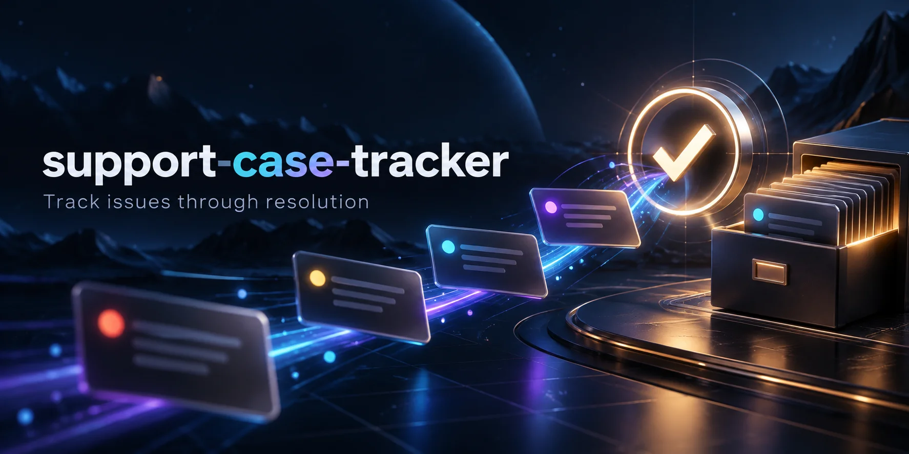

# Support Case Tracker



A local IT support workspace for recording issues, troubleshooting notes, status changes, and resolutions. Python standard library + SQLite + a responsive HTML/CSS/JavaScript interface. Built as a new learning and portfolio project for Jason Edwards; no claim of employer use or prior home-server deployment.

## Run without installing dependencies

Requires Python 3.11 or newer.

```bash
python3 server.py
```

Open http://127.0.0.1:8777. The database is created at `data/cases.sqlite3`, relative to the directory where you run the command. Stop with Ctrl+C and restart with the same database path; your cases persist.

For a stable path independent of your working directory:

```bash
python3 server.py --db "$HOME/.local/share/support-case-tracker/cases.sqlite3"
```

No real customer data is required. The empty-state button loads three **fictional** examples through the same API used for normal cases. It can create duplicates if clicked again after a reload; it is an explicit demo action rather than an automatic seeder.

## Features

- Create cases with a title, reported problem, category, and priority.
- Move among Open, In progress, Waiting, and Resolved.
- Require a written resolution before a case can be resolved.
- Add chronological troubleshooting notes and review status/resolution history.
- Search titles, descriptions, categories, and resolutions; filter by status and priority.
- Export all cases and their history as JSON.
- Persist records in SQLite across restarts; use parameterized SQL and transactional writes.

The queue shows the latest 200 matching cases, ordered by update time. Counts reflect **all** cases, independent of the current filters. The UI refreshes after your actions and filter changes; it does not poll or synchronize edits between multiple browser tabs. Reopening a case is supported. Clearing a resolution adds an event, retaining the previous resolution in history.

## Architecture

The Python HTTP server serves only three static assets and explicit API routes. Each request opens its own SQLite connection; writes to cases and history are committed together. SQLite uses write-ahead logging and a five-second lock timeout. There is no external database service or Python package installation.

| Route | Behavior |
| --- | --- |
| `GET /health` | Check schema/storage availability |
| `GET /api/cases?q=...&status=...&priority=...` | Filtered queue and global status counts |
| `GET /api/cases/1` | Case detail and chronological events |
| `POST /api/cases` | Create case |
| `POST /api/cases/1/status` | Save status and resolution |
| `POST /api/cases/1/notes` | Append troubleshooting note |
| `GET /api/export` | Download all cases/events as JSON |

Example create request:

```bash
curl -H 'Content-Type: application/json' \
  -d '{"title":"Example DNS issue","description":"Fictional lookup failure","category":"Networking","priority":"normal"}' \
  http://127.0.0.1:8777/api/cases
```

Search is literal substring matching, not SQL wildcard matching. Titles accept up to 160 characters; descriptions, notes, and resolutions up to 8,000; categories up to 80. The API accepts JSON POST bodies up to 64 KiB and returns validation errors without changing records. The UI renders user text with `textContent`.

## Optional Docker setup

```bash
docker compose config --quiet
docker compose up --build -d --wait
```

The container runs as an unprivileged user. Its root filesystem is read-only; SQLite writes only to the named `case_data` volume. The port binds to host loopback. `docker compose down` keeps the volume; `down -v` deletes it. The base image tag is not digest-pinned.

## Data and access boundaries

This is a single-user local demonstration, without login, TLS, role-based access, edit conflict detection, or a compliance-grade audit trail. History can be modified by anyone with database access. Do not publish it as a real help desk or enter passwords, tokens, medical information, or real customer details.

The default listener binds to localhost. `--host` exists for container use; avoid exposing a host listener on all interfaces. Other local processes can access the application. For remote viewing use an SSH tunnel rather than a public listener:

```bash
ssh -L 8777:127.0.0.1:8777 YOUR_USER@YOUR_SERVER
```

JSON export has no import command and is not an automatic recovery system. For a full backup, stop the app and copy the complete data directory (including any SQLite WAL/SHM sidecars) to a separate trusted location. Restore that directory while the app is stopped, retaining ownership and private permissions. Database schema migration tooling is not implemented.

## Test

```bash
python3 -m unittest discover -s tests -v
node --check app.js
```

Node is optional for the JavaScript syntax check, not needed to run the app. Nine automated tests run against a real temporary SQLite database and a real HTTP server. They cover case/note/resolution flow, validation and rollback, search/filter behavior, SQL injection-shaped input, persistence, JSON export, missing records, restricted file serving, reopening history, and storage health failure.

With a running instance, `python3 smoke_test.py` exercises the complete case lifecycle over HTTP and export. It leaves one labeled resolved test case in the selected instance; do not point it at a real support database.

Docker startup and visual browser testing must be tracked separately from unit/HTTP tests. The preparation environment lacks Docker and an installed Chromium executable; neither end-to-end container operation nor visual layout has been verified here. The included GitHub Actions job performs tests and optional Compose smoke checks after publication; inspect its actual result before calling CI successful.

## Demonstration script

1. Load the fictional samples.
2. Open the DNS case and add a note: “Compared IP connectivity with a DNS lookup; checked configured resolver.”
3. Mark it In progress.
4. Enter a hypothetical resolution and explicitly note that it is a training exercise.
5. Resolve the case; search for a word from its resolution and review the history.
6. Export JSON, restart the app, and verify that the same case remains.

These exercises demonstrate the tracker, not proof of a real customer incident. Discuss the app as a newly built portfolio project.

## Publish to GitHub

The included publishing script creates **public** repository `cuzzaintit321/support-case-tracker`, commits the project files, and pushes them using the already authenticated GitHub CLI. Review the files first; local database files and exports are ignored. No software license has been chosen on your behalf.

```bash
bash publish.sh
```

The script stops if the repository or a local Git checkout already exists. If a network failure leaves a partially completed publish, inspect the local Git state and remote repository before retrying. A private database export must never be added to the repository.
